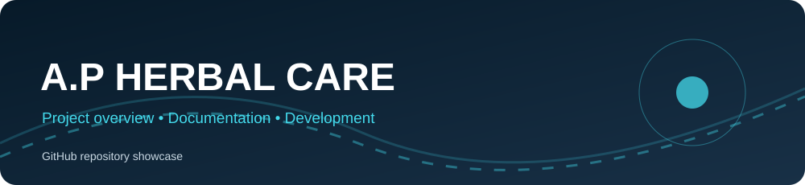

<div align="center">
  
</div>

# A.P Herbal Care – Static Website

**Client:** A.P Herbal Care, Moshi, Tanzania  
**Tagline:** Afya Asilia, Maisha Bora  
**Contact:** 0620 354 744 | augustinojacob4@gmail.com

---

## Project Structure

```
ap-herbal-care/
├── index.html      # Home / landing page (hero + teasers)
├── about.html      # Kuhusu + Kwa Nini Sisi
├── services.html   # Huduma Zetu (all 6 services)
├── products.html   # Bidhaa Zetu (placeholder + gallery for future products)
├── contact.html    # Wasiliana Nasi
├── style.css       # All styles (CSS variables, responsive)
├── main.js         # Nav scroll, mobile menu, animations, page highlighting
├── netlify.toml    # Netlify deploy config
├── images/         # Logo + product/clinic photos
└── README.md       # This file
```

## How to Deploy on Netlify

### Option 1: Drag & Drop (preview only)
1. Use Node.js 22 and run `node scripts/build-site.js` in the repository root.
2. In Netlify, go to **Sites → Add new site → Deploy manually**.
3. Upload only the generated `dist/` directory, never the repository root. Manual uploads do not apply the response headers in `netlify.toml`; use the Git-linked deploy for production.

### Option 2: Via GitHub (recommended for version control)
1. Create a new repo on GitHub: `ap-herbal-care`
2. Push the code:
   ```bash
   cd ap-herbal-care
   git init
   git add .
   git commit -m "Initial commit: A.P Herbal Care website"
   git remote add origin https://github.com/YOUR_USERNAME/ap-herbal-care.git
   git push -u origin main
   ```
3. Go to Netlify → **Add new site → Import from Git**
4. Connect GitHub → Select the repo
5. Use the build command and publish directory from `netlify.toml`: `node scripts/build-site.js` and `dist`.
6. Click **Deploy site**.

### Local checks

Run `node --check main.js && node --test tests/*.test.js` before publishing. The build uses an explicit allowlist in `scripts/build-site.js`; update it when adding a public asset. Repeat builds can reuse `dist/` if it contains only allowlisted site files. To build elsewhere, use `node scripts/build-site.js <output-directory>`.

### Custom Domain (optional)
- In Netlify: Site settings → Domain management → Add custom domain

---

## What Was Built

- Multi-page site: Home, Kuhusu (About), Huduma (Services), Bidhaa (Products), Wasiliana (Contact)
- Consistent responsive navbar + hamburger across all pages
- Hero on home + clean inner page headers
- Full About + Why Us sections on dedicated page
- All 6 service cards on services page
- Products page with "Inatayarishwa" placeholders + image gallery (ready for real products)
- Contact page with 4 info cards + CTA
- Footer links updated for multi-page
- Scroll-triggered fade-in animations
- Active nav link highlighting (current page)
- Fully mobile responsive (breakpoints: 900px, 600px)

---

## Notes

- The site was split from a single page into multiple pages so that **product listings** (Bidhaa) can be developed independently as real products become available.
- Use relative links like `about.html`, `products.html` etc.
- Netlify serves each `.html` file directly. No catch-all SPA redirect.

*Built during MWECAU ICT Club Week 2026 — Technology Beyond the Classroom*

---

<!-- Developer contact links -->
<div align="center">
  <h3>Connect with the developer</h3>
  <a href="https://wa.me/255698170989?text=Habari%20John%2C%20nimeona%20project%20yako%20GitHub.">
    
  </a>
  <a href="https://john-charles-sarwi-portfolio.vercel.app/">
    
  </a>
  <p><strong>Developer:</strong> <a href="https://john-charles-sarwi-portfolio.vercel.app/">John Charles Sarwi</a> · Tanzania</p>
</div>
<!-- End developer contact links -->
